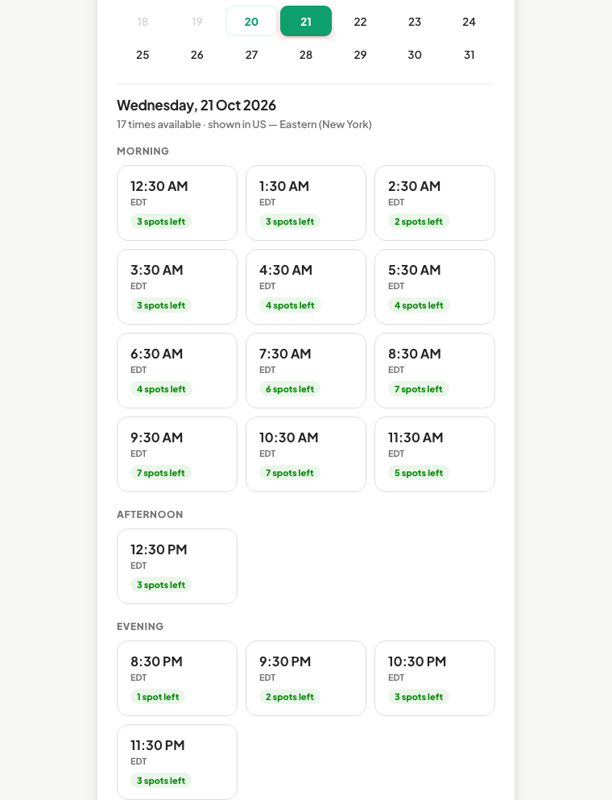
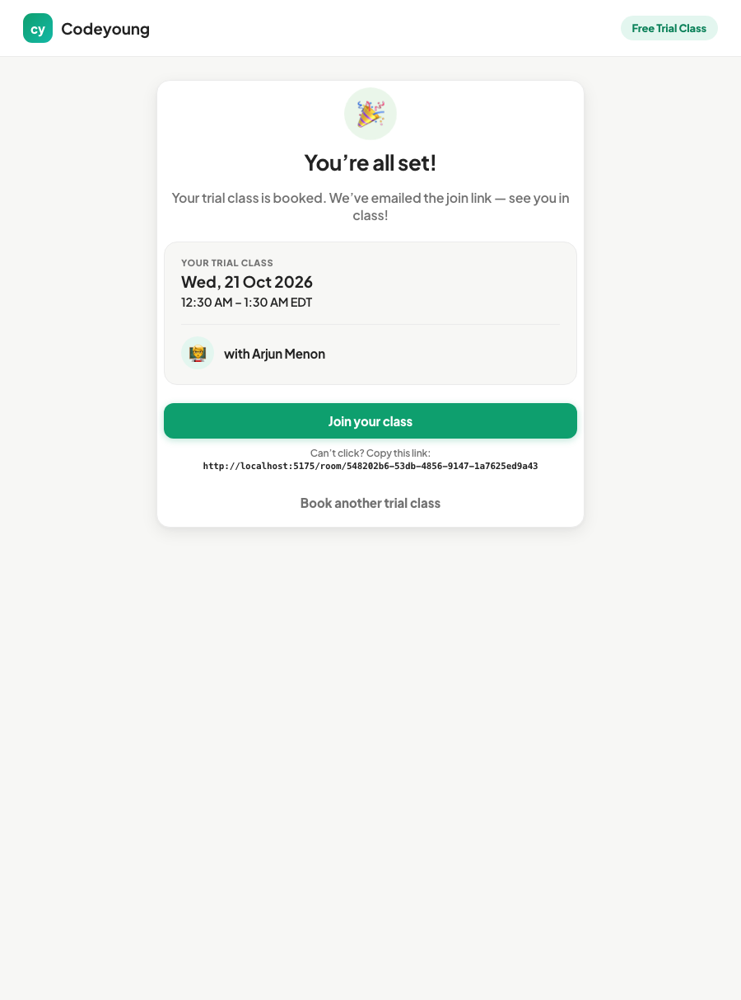
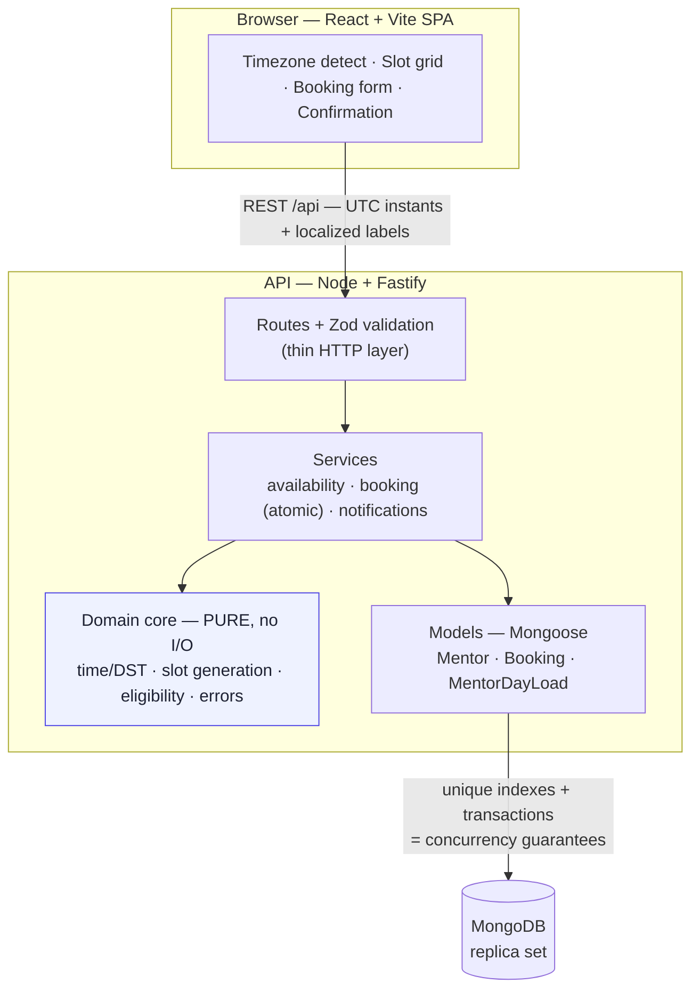
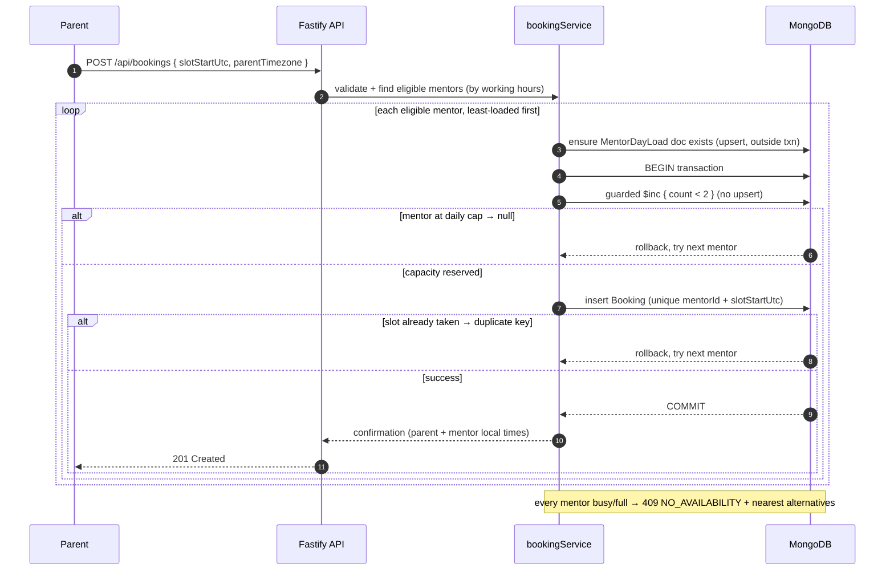

# Codeyoung — Trial Class Booking

A booking web app where a parent (typically in the **US or UK**) picks a convenient time,
the system **auto-assigns an available mentor** (in **India**), and both parties get the
class details and a join link — each shown in **their own local time**, with Daylight Saving
Time handled correctly and mentor capacity + concurrent bookings enforced safely.

> Built for the Codeyoung Senior Full Stack Engineer assignment.
> AI-assisted development transcript: [`TRANSCRIPT.md`](./TRANSCRIPT.md).

---

## Screens

| Parent in New York picks a date → sees times in EDT | Confirmation (parent's local time) |
| --- | --- |
|  |  |

A US parent picks a date on the calendar and every slot renders in their own timezone
(EDT/EST). The confirmation shows the class in the **parent's** local time with the assigned
mentor; the mentor gets their own IST time via the (stubbed) notification.

---

## Table of contents

- [Quick start](#quick-start)
- [Tech stack & why](#tech-stack--why)
- [How the hard requirements are handled](#how-the-hard-requirements-are-handled)
- [Architecture](#architecture)
- [Project structure](#project-structure)
- [Environment variables](#environment-variables)
- [API reference](#api-reference)
- [Testing](#testing)
- [Assumptions & trade-offs](#assumptions--trade-offs)
- [What I deliberately did *not* build](#what-i-deliberately-did-not-build)
- [Scaling notes](#scaling-notes)

---

## Quick start

**Prerequisites:** Node.js ≥ 20, Docker (for MongoDB). Three terminals, ~2 minutes.

```bash
# 1) Start MongoDB (single-node replica set — needed for transactions).
#    The compose file auto-initiates the replica set; just run:
docker compose up -d

# 2) Backend
cd backend
cp .env.example .env         # defaults work out of the box
npm install
npm run seed                 # inserts the 10 mentors, clears old bookings
npm run dev                  # API on http://localhost:4000

# 3) Frontend
cd ../frontend
npm install
npm run dev                  # app on http://localhost:5173
```

Open **http://localhost:5173**. Your timezone is auto-detected (change it to, e.g., “US —
Eastern”); pick a date on the calendar to reveal available class times in your local zone,
then book.

> **Port already in use?**
> - API: `PORT=4100 npm run dev`, and point the frontend at it with
>   `VITE_API_TARGET=http://localhost:4100 npm run dev`.
> - MongoDB (e.g. a local `mongod` already on 27017): bring it up on another host port with
>   `MONGO_HOST_PORT=27018 docker compose up -d`, then set `MONGODB_URI=...localhost:27018...`
>   in `backend/.env`.

**Run the tests** (no Docker needed — tests spin up their own in-memory Mongo):

```bash
cd backend && npm test
```

---

## Tech stack & why

| Layer | Choice | Why |
| --- | --- | --- |
| Backend | **Node + TypeScript + Fastify** | Strong typing across the domain; Fastify is fast, small, and has first-class schema/validation ergonomics. |
| Time | **Luxon** | IANA-zone aware. DST is handled by the zone database, never by hardcoded offsets. |
| Validation | **Zod** | Declarative request validation at the API boundary. |
| DB | **MongoDB + Mongoose** | Flexible document model; **unique indexes + transactions** give us real, race-free booking guarantees (see below). |
| Frontend | **React + Vite + TypeScript** | Fast DX; a small, focused single-page booking flow. |
| Tests | **Vitest + mongodb-memory-server** | Pure-domain unit tests + DB-backed integration/concurrency tests that need no running services. |

---

## How the hard requirements are handled

### 🌍 Time zones — always local, never ambiguous
- **UTC is the single source of truth.** Every instant is stored as a UTC `Date`
  (`slotStartUtc`). Wall-clock times are *derived* per user via Luxon.
- Mentors' working hours are defined in **their** local zone (`Asia/Kolkata`); the parent
  sees every slot in **their** zone. The parent's confirmation shows the class in the parent's
  timezone; the mentor receives their own IST time via the stubbed notification. (The API's
  booking response carries both `parentView` and `mentorView` so each side can render its own.)
- Every displayed time carries a **zone abbreviation** (EDT, EST, GMT, BST, IST…) so a time
  is never ambiguous. (`backend/src/domain/time.ts`)

### ☀️ Daylight Saving Time — no fixed offsets
- Because conversions go through IANA zones, DST is automatic. Two concrete places this
  matters, both covered by tests:
  - **Rendering:** New York noon is `EDT` in July and `EST` in January; London is `BST` vs `GMT`.
  - **Day boundaries:** a parent's calendar day is bounded by real zone midnights, so a US
    “spring forward” day is **23 h** wide and a “fall back” day is **25 h** wide
    (`dayWindowUtc`). We never assume 24 h.
- Arizona (`America/Phoenix`, no DST) and UK/Ireland rules are handled by the same mechanism.

### 👩‍🏫 Mentor assignment + 🔢 daily capacity (max 2/day)
- The parent never picks a mentor — they pick a **time**, and the system assigns an eligible
  mentor, **load-balanced** (fewest classes that day first) for fairness.
- The 2-per-day cap is keyed on the **mentor's local date**, enforced by an atomic counter
  (`MentorDayLoad`): the counter document is ensured to exist *before* the transaction, then a
  guarded `{ count: { $lt: 2 } } → $inc` (no upsert) runs *inside* it. Because the document
  already exists, concurrent bookings contend on that one doc and serialise cleanly.

### 🔒 Concurrency — two parents, same instant
This is the correctness crux, and it's enforced at the **database** level, not in app code:
1. A **unique index** on `{ mentorId, slotStartUtc }` makes double-booking a mentor into the
   same slot physically impossible.
2. A **MongoDB transaction** ties “reserve a daily slot” (the guarded counter increment) and
   “create the booking” into one atomic unit. Concurrent bookings for the same mentor contend
   on the same counter document, so Mongo serialises them (a write conflict is retried) and the
   cap can never be exceeded — nor a booking spuriously rejected.
3. If a mentor turns out to be taken/full mid-transaction, it rolls back and the service
   transparently tries the **next** eligible mentor.

Covered by concurrency tests: *two simultaneous bookings for the same slot get two distinct
mentors*; *three simultaneous with two mentors → exactly two succeed*; *three parallel on one
mentor cap at two*; and a *fresh-day race* regression guard (two parallel bookings on a mentor
with no counter doc yet both succeed).

### 🚫 No availability — a helpful dead-end, not an error
If every eligible mentor is busy or at capacity, the API returns `409 NO_AVAILABILITY` with
the **nearest available alternative slots**, and the UI shows a friendly state offering those
slots one click away (rather than a raw error).

---

## Architecture

Layered, with a dependency-free **domain core** that holds all the tricky time logic and is
exhaustively unit-tested in isolation.



### Booking & concurrency flow

How a booking is assigned atomically, and how the capacity / double-booking guarantees hold
when two parents race for the same slot:



**Key design decisions**
- *Pure domain, impure edges.* All DST/slot math is pure functions → trivially testable,
  no mocks. Persistence and HTTP sit at the edges.
- *Correctness in the database, not in `if`-statements.* Unique indexes + a transactional
  counter beat application-level locking and survive multiple API instances.
- *Server formats times.* The API returns both the raw UTC ISO and ready-to-display
  localized labels, so the client can't drift from the server's DST logic.

---

## Project structure

```
.
├── docker-compose.yml          # MongoDB single-node replica set (auto-initiated)
├── scripts/smoke-test.sh       # reproducible API end-to-end check
├── e2e/booking-flow.mjs        # reproducible real-browser check (Chrome DevTools)
├── docs/                       # screenshots used in this README
├── backend/
│   └── src/
│       ├── config/             # env, business constants, mentor seed, timezone list
│       ├── domain/             # PURE: time/DST, slot generation, types, errors
│       ├── models/             # Mongoose schemas + indexes
│       ├── services/           # availability, booking (atomic), notifications (stub)
│       ├── routes/             # Fastify route handlers (thin)
│       ├── plugins/            # db connection, error handler
│       ├── scripts/seed.ts     # seed the 10 mentors
│       ├── app.ts / server.ts
│   └── tests/                  # domain unit tests + DB integration/concurrency tests
└── frontend/
    └── src/
        ├── api/                # typed client + response types
        ├── components/         # TimezoneSelect, Calendar, SlotGrid, BookingForm, Confirmation, NoAvailability
        ├── pages/              # DemoClassRoom (where the class link opens)
        ├── hooks/              # useModal (dialog a11y: focus trap, Escape)
        ├── lib/                # browser timezone detection + display helpers
        └── App.tsx             # booking flow state machine (date-first slot reveal)
```

---

## Environment variables

`backend/.env` (see `backend/.env.example`):

| Variable | Default | Purpose |
| --- | --- | --- |
| `PORT` | `4000` | API port |
| `MONGODB_URI` | `mongodb://localhost:27017/codeyoung?replicaSet=rs0&directConnection=true` | Mongo connection (replica set required for transactions) |
| `CORS_ORIGIN` | `http://localhost:5173` | Comma-separated allowed origins |
| `CLASS_LINK_BASE_URL` | `http://localhost:5173/room` | Base of the (dummy) class link; opens the in-app demo room. In production, the real video platform. |

Frontend: `VITE_API_TARGET` (default `http://localhost:4000`) — where the dev server proxies `/api`.

> **The class link is a deliberate dummy** (per the brief). Rather than a dead URL, it opens an
> in-app **demo class room** page so the booking journey has a working end-to-end destination.

---

## API reference

Base URL: `http://localhost:4000`

### `GET /api/health`
`200 → { "status": "ok" }`

### `GET /api/config`
Timezone options + booking rules for the UI.

### `GET /api/availability?timezone=<IANA>&date=<yyyy-MM-dd>`
Slots for that parent-local date, in the parent's timezone.
```jsonc
{
  "date": "2026-10-21",
  "timezone": "America/New_York",
  "slots": [
    {
      "startUtc": "2026-10-21T13:30:00.000Z",
      "endUtc":   "2026-10-21T14:30:00.000Z",
      "start": { "timeLabel": "9:30 AM", "abbreviation": "EDT", "full": "Wed, 21 Oct 2026, 9:30 AM EDT", "...": "..." },
      "availableMentorCount": 7,
      "isAvailable": true
    }
  ]
}
```

### `POST /api/bookings`
```jsonc
// request
{ "parentName": "Priya Sharma", "parentEmail": "priya@example.com",
  "parentTimezone": "America/New_York", "slotStartUtc": "2026-10-21T13:30:00.000Z" }

// 201 → confirmation (same instant in both zones)
{ "id": "...", "mentor": { "name": "Aarav Sharma", "timezone": "Asia/Kolkata" },
  "classLink": "http://localhost:5173/room/<uuid>?with=<mentor>&at=<parent-local-time>",
  "parentView": { "start": { "full": "Wed, 21 Oct 2026, 9:30 AM EDT" }, "...": "..." },
  "mentorView": { "start": { "full": "Wed, 21 Oct 2026, 7:00 PM IST" }, "...": "..." } }
```

**Error shape** (all errors): `{ "error": { "code", "message", "details"? } }`
- `400 VALIDATION_ERROR` — bad input.
- `409 NO_AVAILABILITY` — no mentor free; `details.alternatives` holds nearest open slots.

---

## Testing

```bash
cd backend && npm test        # 25 tests, no Docker needed
```

- **Domain (no DB):** DST rendering (EDT/EST, GMT/BST, IST), 23h/25h DST-transition days,
  slot generation & UTC anchoring, parent-day windowing, fixed-offset-zone rejection.
- **Integration (in-memory replica set):** happy-path dual-timezone confirmation; daily cap
  (2/day); no double-booking a slot; `NO_AVAILABILITY` with alternatives; **daily-cap display
  correctness across the window boundary**.
- **Concurrency:** simultaneous bookings assigned distinct mentors; over-subscription capped
  exactly; per-mentor daily cap holds under parallel load; **fresh-day race** (two parallel
  bookings on a mentor with no counter doc yet both succeed — a regression guard).

**Reproducible end-to-end checks** (need the app running + seeded):
```bash
BASE_URL=http://localhost:4000 ./scripts/smoke-test.sh      # API: health → availability → booking
APP_URL=http://localhost:5173  node e2e/booking-flow.mjs    # real browser (Chrome DevTools)
```
The smoke test asserts the booked instant matches in both the parent's and the mentor's
timezones; the browser E2E drives the real UI (pick date → slot → confirm) and checks the
parent-local class time and the assigned mentor. The browser E2E saves screenshots next to
the script.

---

## Assumptions & trade-offs

- **Slots are hourly, 60-minute trial classes**, on the hour, within each mentor's working
  window. Easy to change in `backend/src/config/constants.ts`.
- **“Per day” = the mentor's local (IST) calendar day.** Mentor working windows are seeded so
  none crosses local midnight, keeping “per day” unambiguous.
- **Notifications are stubbed** (logged to the server console) — the assignment says the link
  can be a dummy and is assumed to work. Swapping in SES/SendGrid is a one-file change in
  `notificationService.ts`.
- **No login.** A parent provides name + email per booking; this mirrors a top-of-funnel trial
  flow where friction must be minimal. A parent *could* book multiple trials — deliberately
  allowed (see below).
- **A minimum 30-minute booking lead time** prevents booking a class that's about to start;
  past/too-soon slots are hidden.
- **Replica set for a single node** is used only so MongoDB transactions are available; the
  compose file sets this up automatically.

---

## What I deliberately did *not* build

Per the brief's emphasis on judgment (“a good part of this evaluation is what you do & don't
build”), I kept scope tight and customer-focused:

- **Auth / accounts** — unnecessary friction for a trial-booking top-of-funnel.
- **Reschedule / cancel** — valuable later, but not core to proving the booking + timezone +
  concurrency problem. (Note: I left `MentorDayLoad` without decrement logic precisely because
  there's no cancellation yet; adding cancel means adding a compensating decrement.)
- **A mentor-facing dashboard** — the mentor's view is represented by the confirmation payload
  rendered in IST and the stubbed notification.
- **Payments, recordings, real video rooms** — out of scope; the link is a dummy by design.
- **Per-parent duplicate-trial prevention** — easy to add (unique index on parent email), but
  product-dependent, so left as a documented assumption rather than an assumed rule.

---

## Scaling notes

The design already fits far more than 20 bookings/day:
- Correctness lives in **database constraints + transactions**, so it holds across *multiple
  API instances* — no sticky sessions or in-process locks.
- Availability reads are O(mentors × slots) over a single day and index-backed; they'd move
  behind a short cache if traffic grew.
- Mentor working hours and slot length are data/config, not code — onboarding mentors or
  changing class duration needs no rewrite.
